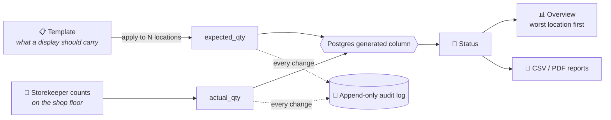
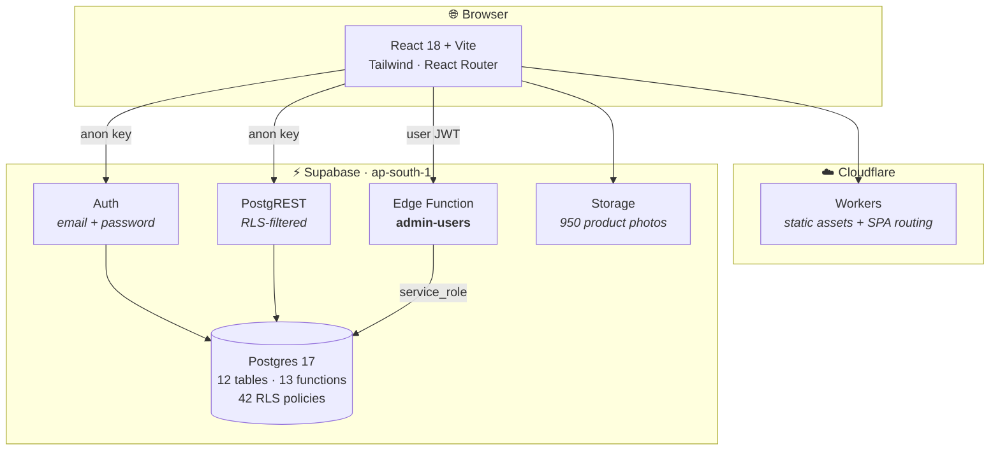
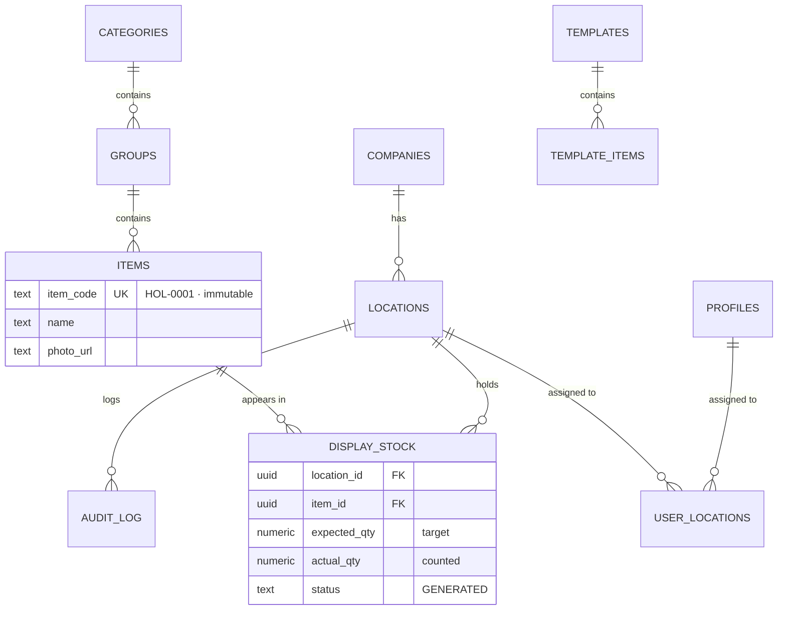

<div align="center">

# Display Inventory

### Know what is **actually** sitting on every retail display — across five companies, in one glance.

[](https://react.dev)
[](https://vite.dev)
[](https://tailwindcss.com)
[](https://supabase.com)
[](https://workers.cloudflare.com)

<br />

`1,022 items` · `950 product photos` · `73 groups` · `5 companies` · `4 roles` · `42 RLS policies`

</div>

---

## The problem

A display inventory is not a stock ledger.

A ledger answers *how much do we have*. A display answers something harder — **what is missing**. And you cannot find a missing item by listing what is present, because the missing one is, by definition, not in the list.

So the system carries two numbers for every item at every location:

| | meaning | who sets it |
|---|---|---|
| **`expected_qty`** | what *should* be on this display | admin, via a template |
| **`actual_qty`** | what *is* on this display right now | storekeeper, by counting |

Everything else in this app — the colours, the dashboard, the alerts — is a consequence of comparing those two numbers.

```
expected  actual   status        what it means
───────────────────────────────────────────────────────────────
   5         5     ✅ Stocked    shelf matches the plan
   5         2     ⚠️  Short      refill it
   5         0     ❌ Missing    gone — the headline case
   5         8     ↗️  Excess     overstocked
   0         3     ◻️  Unplanned  present, but never planned for
   0         0     ·  Inactive   not carried here
```

`status` is a **`STORED GENERATED` column** in Postgres. It is computed by the database, never written by the application — so a count recorded on a phone, a report exported to PDF, and the dashboard can never disagree about whether an item is missing.

---

## How a display stays honest



A **template** is a reusable list of what a display should carry. Build it once, apply it to twenty locations in one click — otherwise setting a target for 60 items across 20 locations means typing 1,200 numbers by hand.

Templates **copy** values rather than staying linked. A later edit to the template does not silently rewrite twenty locations; you re-apply deliberately. One careless edit should not be able to corrupt a whole network.

---

## Screens

| Screen | What it does |
|---|---|
| **Overview** | Every active display as a proportional status bar, worst location first |
| **Locations** | Company filter, full CRUD, drill into any display |
| **Location detail** | Count, move stock in/out, bulk-add from the catalog, live status |
| **Catalog** | Category → Group → Item drill-down, 1,022 items with photos |
| **Templates** | Build an item list, apply it to many locations at once |
| **Activity** | Append-only history of every change, with CSV export |
| **People** | Create accounts, assign roles and locations |

### The Overview bar

Each location renders as one horizontal strip, segment widths proportional to item counts. A red-heavy strip is an empty display; a green strip is a healthy one. It is not decoration — it is the shape of the data, readable at arm's length without reading a single number.

---

## Roles

| Role | Can see | Can count | Can change setup |
|---|---|---|---|
| `super_admin` | everything | everywhere | ✅ |
| `manager` | their company | their company | ❌ |
| `storekeeper` | assigned locations only | assigned locations only | ❌ |
| `viewer` | everything | ❌ | ❌ |

Scoping is enforced in **Row Level Security**, not in the UI. A storekeeper querying the API directly still sees only their own locations.

Two rules live in the database specifically because the UI is not a security boundary:

- **A storekeeper cannot change `expected_qty`.** If the person counting could also lower the target, "missing" would lose its meaning — an unfound item could simply be targeted away.
- **Nobody can remove their own admin access.** One wrong click should not leave the database with zero admins.

---

## Architecture



**Why an Edge Function for user management.** Creating an account requires the `service_role` key, which bypasses RLS entirely. That key must never reach the browser, so account creation runs server-side. The function verifies the caller is a super admin by reading their role **from the database** — not by trusting the role claim in the JWT, which the client supplies.

---

## Data model



### Item codes

Every item gets a code derived from its category prefix — `HOL-0001`, `POO-0042`, `RNG-0107` — generated by a database trigger holding a row lock, so two concurrent inserts can never collide on the same number.

Once issued, a code is **immutable**. A separate trigger rejects any attempt to change it. The code has left the database by then: printed on labels, referenced in exported reports, used as the storage filename for the item's photo. Reassigning it would orphan every one of those.

---

## Tech stack

<table>
<tr><td><b>Frontend</b></td><td>React 18 · Vite 8 · Tailwind CSS 3 · React Router 6 · jsPDF</td></tr>
<tr><td><b>Backend</b></td><td>Supabase — Postgres 17, Row Level Security, Edge Functions (Deno), Storage</td></tr>
<tr><td><b>Hosting</b></td><td>Cloudflare Workers (static assets)</td></tr>
<tr><td><b>CI</b></td><td>GitHub Actions — daily keep-alive ping</td></tr>
</table>

### Interface

Dark glassmorphism over an indigo field. The chrome — sidebar, modals, top bar — is frosted and deliberately neutral; **colour is reserved entirely for data**. When the only saturated thing on screen is a red "Missing" chip, the eye goes straight to it.

The status palette is named after the trade the business is in — pigments, not hex codes:

`neel` · `gulal` · `haldi` · `mehndi` · `kesar` · `raakh`

---

## Getting started

```bash
git clone https://github.com/ai0tota/Display-Inventory.git
cd Display-Inventory
npm install
cp .env.example .env     # fill in your Supabase URL + publishable key
npm run dev              # → http://localhost:5173
```

```bash
VITE_SUPABASE_URL=https://<project-ref>.supabase.co
VITE_SUPABASE_ANON_KEY=sb_publishable_xxxxxxxxxxxx
```

> The publishable key is **meant** to be public — it ships inside the JS bundle either way. Security lives in the RLS policies, not in hiding the key. The `service_role` key must never appear in this file or anywhere in the client.

### First-time Supabase setup

| # | Where | What |
|---|---|---|
| 1 | Storage | Create a **public** bucket named `item-photos` |
| 2 | Authentication → Sign In / Providers | Enable leaked-password protection |
| 3 | Authentication → URL Configuration | Set Site URL to your deployed URL |

The first sign-in by a seeded admin email is promoted to `super_admin` automatically by a trigger on `auth.users`. No manual step.

---

## Deployment

```bash
npm run build     # → dist/
git push          # Cloudflare builds and deploys from main
```

| Setting | Value |
|---|---|
| Build command | `npm run build` |
| Output directory | `dist` |
| Node version | `20` |
| Environment variables | `VITE_SUPABASE_URL`, `VITE_SUPABASE_ANON_KEY` |

Vite inlines `VITE_*` variables **at build time**. Adding or changing one requires a redeploy — setting it at runtime has no effect, because the bundle was already written.

### Keeping the project awake

A free-tier Supabase project pauses after 7 days without activity. This app is seasonal — it can sit untouched for months — so `.github/workflows/keep-alive.yml` pings a `ping()` RPC daily.

That RPC returns the string `ok` and nothing else. The anon role has **no** read access to any table, and a health check is not a good enough reason to open one up.

> **Note:** GitHub disables scheduled workflows after 60 days of repository inactivity, and emails you first. Re-enable it from the Actions tab if that happens.

---

## Project structure

```
src/
├── lib/
│   ├── supabase.js     client, fails fast on missing env
│   ├── api.js          every database call, in one place
│   ├── auth.jsx        session + role context
│   └── scope.js        role-based visibility helpers
├── components/
│   ├── Shell.jsx       sidebar (desktop) / bottom tabs (mobile)
│   ├── ui.jsx          StatusChip · PigmentBar · Modal · Empty · ErrorNote
│   ├── Backdrop.jsx    ambient gradient layer
│   └── ErrorBoundary.jsx
└── pages/
    ├── Login.jsx          Dashboard.jsx      Locations.jsx
    ├── LocationDetail.jsx Catalog.jsx        Templates.jsx
    └── Activity.jsx       Users.jsx
```

Every database call lives in `lib/api.js`. Components never build queries themselves — when a query needs to change, there is exactly one place to change it.

---

## Design decisions worth knowing

<details>
<summary><b>Categories are rows, not an ENUM</b></summary>

<br />

Product categories change every season — Holi, Pooja, Hing, Rangoli, Food Colour. Postgres `ALTER TYPE … ADD VALUE` cannot run inside a transaction (which breaks atomic migrations), and an enum value can never be deleted.

**Rule:** anything a user can edit is a table, never an enum. Adding a category is an `INSERT` from the UI, not a migration and a deploy.

</details>

<details>
<summary><b>The audit log is append-only, even for admins</b></summary>

<br />

`display_audit_log` has an `INSERT` policy and deliberately **no** `UPDATE` or `DELETE` policy. Under RLS, an action with no policy is always denied — so history cannot be rewritten by anyone, including a super admin.

</details>

<details>
<summary><b>Deletes are restricted, not cascaded</b></summary>

<br />

Foreign keys use `ON DELETE RESTRICT`. Deleting a category with `CASCADE` would silently take its groups, its items, every stock row for those items, and their entire movement history.

`RESTRICT` makes the database refuse and say why. In practice the right answer is almost always `is_active = false` rather than a delete.

</details>

<details>
<summary><b>Bulk operations are one transaction</b></summary>

<br />

Adding twelve items to a display runs as a single `bulk_stock_in` RPC, not twelve API calls. If one quantity is invalid, the whole batch rolls back.

Looping client-side means eight succeed, four fail, and nobody can tell which — the worst possible outcome for an inventory system.

</details>

<details>
<summary><b>Counting and moving are different verbs</b></summary>

<br />

`record_display_check` sets an **absolute** value — the result of counting what is on the shelf.
`move_display_stock` applies a **delta** — five arrived, three sold.

They are separate RPCs because they answer different questions, and merging them would make both ambiguous. Outward moves additionally require a person's name; inward moves do not, because gating every delivery behind a form is how logs start containing fiction.

</details>

<details>
<summary><b>14 migrations, each reversible in intent</b></summary>

<br />

Schema history runs from `01_profiles_and_auth_foundation` to `13_public_ping_for_keepalive`, including a dedicated `06_security_hardening` pass (pinned `search_path` on every function, revoked anon access) and `12_performance_tuning` (wrapping `auth.uid()` in a subquery so RLS evaluates it once per query rather than once per row).

</details>

---

<div align="center">

Built for **RB Industries / TOTA** — RBDC · VCPL · RBRR · RBI · Spark International

</div>
